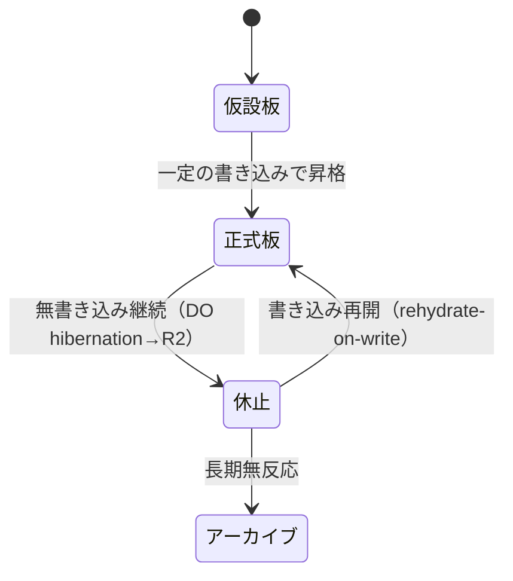

# 3ch掲示板 板戦略・広告戦略 方針企画書

Sep 21, 2026 · @k

3ch（v6, 3ch.io）の生存戦略。この業界の5F構造は全方位で不利なため、目的を広告収益の最大化ではなく生存確率の最大化に置き、専門板の自然発生・なんG避難イベントへの備え・旧2ch型直販モデルの反転移植を三本柱とする。

## 業界構造とKSF

3chは広告主向けのアテンションメディア業であり、利用者は顧客ではなく無償の仕入先にあたる。

| 力 | 強度 | 核心 |
| --- | --- | --- |
| 既存企業間の敵対 | 中〜高 | 競争単位は板・スレ単位。サイト全体ではない |
| 新規参入 | 見かけ高／実質低 | ネットワーク外部性とアーカイブ資産が実質障壁 |
| 代替品 | 最強 | X・Discord・まとめサイト・LLM。ただし完全匿名・トピック中心・検索可能アーカイブは代替されていない |
| 売り手の交渉力 | 最強 | 住民は無償で離脱、インフラは一社の判断で停止しうる（2026年3月、5ch.netがレジストラEpikにより永久停止） |
| 買い手の交渉力 | 高 | 広告主はアドネットワーク経由。ブランドセーフティ最低ランクで単価が低い |

**KSF（優先順）**

1. 板単位のクリティカルマス（サイト全体DAUではない）
2. 荒らし・スクリプト対策の自動化
3. 1投稿あたりの限界費用の最小化
4. インフラ主権と可搬性（ドメイン・決済を差し替え可能に）
5. まとめサイト等、互換エコシステムとの接続
6. 法的耐性（削除依頼・発信者情報開示請求への体制）

## 板戦略

**総合板＝獲得装置、専門板＝定着装置。** 総合板（なんG型）は実況・雑談の密度が必要で後発が勝てないが、避難イベント時にのみ強力な流入経路になる。専門板は非同期で成立し、後発が唯一クリティカルマスを満たせる領域。

**専門板は「立てる」ものではなく「生える」もの。** 5ch専門板の住民を外部から引き剥がすのは、移住コストの問題ではなく臨界人数（協調ゲーム）の問題で、5chの過疎化とともに移住能力自体が失われている。運営が狙って板を作っても定着しない。狙うべきは、3ch自身の住民から自然発生する専門板が生まれる土壌を維持することのみ。

**ユーザーによる板作成機能が構造的優位を生む。** 5chは板新設が硬直的（新トピックに追随できない）、したらばは板が孤立（横断性ゼロ）。3chは両方の弱点を同時に解消できる唯一の設計。

板一覧のデフォルトは直近アクティビティ順とし、全板一覧を「墓場」に見せない。板生成には平時は軽い摩擦（実績条件など）を入れ、乱造を抑止する。

## 獲得チャネルと生存ポジショニング

**獲得チャネルは3つ、性質が全く異なる。**

| チャネル | 性質 | 評価 |
| --- | --- | --- |
| なんG系避難イベント | 不定期・確率的・最大瞬間風速 | 最重要。約3年前に3chなんG板が1日1万書き込み超を記録した実績あり |
| 5chに板がない新規トピック | 定常・小規模・自力成長 | 唯一の能動的・恒常的チャネル |
| SEO（専門板の深いログ） | 定常・受動的・複利 | 総合板では効かない。専門板が育った結果としての副産物 |

**現在の階層と3chの不在。** 本国＝5ch なんG、移住先＝エッヂ（個人運営、広告なし）、避難所＝紅茶掲示板（放置され潰れそう）。3chはこの階層のどこにも入っていない。約3年前に3ch自身が避難所の座を占めていたが、現在はその席を失っている。

**紅茶掲示板の教訓：死因は運営者の不在であり、トラフィック不足ではない。** 有力避難先ですら無償の善意による運営は続かない。真のKSFは「運営者が動かなくても死なない設計」——モデレーション自動化、板の生成・休眠の自動化、放置に数年耐えるインフラ、無視できるコスト。エッヂの「広告なしで5年持たない」という見立ても、金銭より先に運営者離脱・法務コスト・インフラ供給者リスクによる突然死を警戒すべき。

**3chが取るべき位置：常設の避難所（エッヂの死に対するコールオプション）。** 保有コストはほぼゼロ、行使時の利得は大きい。実務は3点——①席を空けておく（無人でも荒れず存在し続ける常設板）②到達可能性の確保（紅茶掲示板の住民が離散する前に受け皿の存在を伝える）③落ちない構成の事前検証。

**有事対応（避難イベント発生時に切り替えること）**

- 広告の露出を止める、または最小化する（運営不信への感度が高い時期）
- 板生成の摩擦を一時的に下げる「避難モード」トグル
- スクリプト対策・削除依頼対応体制は事前に完成させておく（事後着手は間に合わない）

**VIP／ν速／嫌儲の扱い。** VIP・ν速はコンテンツが既に外部サービスへ移住済みの「跡地」で狙わない。嫌儲は住民が残るのに競合避難先がない本物の空白だが、避難所文化がなく席を用意しても自然には埋まらないため、存在の事前告知が必須。また嫌儲は広告への文化的敵意が強く、板単位で広告の有無を切り替えられる設計を前提に検討する。

## 過去ログ・SEO活用方針

**旧3chの専門板履歴は年代で証拠価値が異なる。** 2004-2010年（板数多い）は当時代替サービスが存在しなかった時代の遺物で、戦略の妥当性を直接は証明しない。2022-23年（僅かだがなんG経由で定着）は、現在の競争環境下で「生える板」モデルが実際に機能した直近の実例であり、KSFの精度を上げる最重要データ。具体的にどのテーマが定着したかは要調査。

**過去ログの活用法**

1. 板の再着火材料：同テーマの新規板に過去ログを繋げ、「空の板」による離脱を防ぐ（3ch自身のコンテンツなので権利問題なし。5chログの転載とは別物）
2. 2022-23年の成功・失敗のケーススタディ化
3. 掘り起こしマーケティングは匿名性ゆえ期待値が低い

**SEOは2026年3月のGoogleコアアップデートで独立チャネルとしての価値が下がった。** 2023〜2025年はUGC・フォーラムサイトの検索露出が伸びていたが、直近のコアアップデートでアグリゲーター・UGCの露出が大きく低下（Redditは部分回復も不安定）。生き残る条件は「規模＋実体験の厚み＋積極的なモデレーション＋ニッチへの特化」——これは総合板では満たせず、専門板の深いログでのみ満たせる。SEOは専門板戦略が機能した場合の副産物として位置づける。

**技術要件（実装前に確認）**

- 休眠板でも静的にクロール可能であること（DO起動なしにR2から直接HTMLを返す経路）
- 旧ドメイン（3chbbs.com）からの移行でURL・301リダイレクトが維持されているか
- 古い誹謗中傷系スレッドをSEOで再浮上させない配慮（削除要請・法務リスク）

## 広告戦略（商用直販）

**2002年当時の2ch.net広告モデルを、変数を反転させて移植する。**

| 変数 | 2002年の2ch | 3ch |
| --- | --- | --- |
| 売るもの | 代替不能な規模 | 板の濃度・ニッチ性 |
| 販売経路 | 代理店（東京アクセス） | セルフサーブ |
| 枠の粒度 | 物理サーバ単位 | 板・スレ単位（任意粒度） |
| 効果測定 | なし（ログなしと明言） | imp/click計測あり（匿名性を損なわず実装可能） |
| 価格勾配 | 広い枠ほど割安（バンドル割引大） | 狭い枠ほど割高（ニッチにプレミアム） |
| 成人向け扱い | bbspink.comとしてドメイン分離済み | 同様に最初から分離 |

**枠は3層。** 全板共通枠（最安・在庫消化・個人出稿の入口）／板指定枠（主力・アクティビティ連動）／スレ指定枠（実験・突発需要向け）。個人・非商用と法人・商用で単価と審査を分ける。

**フェーズはイベント基準（時間基準ではない）。** Phase1: 板が育つまで広告なし。Phase2: 個人セルフサーブのみで審査・決済パイプラインを検証。Phase3: 板単位の商用直販——着手前に、対象領域に金を払ってでもリーチしたい事業者が実在するかを確認する。

**やらないこと：** 全体PVを売る／審査の手動スケール／5chと同じ広告主層を狙う／「ユーザー構成が平均的」という訴求／収益額をKPIに置く（KPIは板あたりアクティビティとコスト/投稿）。

## 個人支援型出稿（返礼設計）

**寄付ではなく返礼にする狙い：同額でも「対価」として意思決定できるため心理的抵抗が下がる。** ただしMisskey.io型（顕名が前提の文化）をそのまま移植すると、匿名掲示板の自己宣伝＝叩きの対象という文化と衝突する。

**設計原則（4点）**

1. 匿名性を返礼側にも継承——完全匿名・トリップのみでの出稿を選べる（Misskeyの顕名義務とは逆）
2. 表示位置を本文の外に分離——「支援者コーナー」として独立させ、読書体験を汚さない
3. UI上の呼称を「広告」ではなく「支援」「投げ銭」にする
4. 個人枠は非商用限定（自分の作品・メッセージのみ可、事業宣伝は商用枠へ）——景表法等の規制対象からも外れやすい

**したらば型「広告非表示権」との併用。** 匿名掲示板の住民は「足したい」より「消したい」動機が強い層も多い。広告非表示権（消したい人向け）と支援バナー掲出権（残したい人向け）を並行提供し、同一予算で両方の動機を拾う。

**希少性を「見られること」の代替報酬にする。** 1日の出稿枠数を絞ることで、価値の源泉を「見られること」から「希少な枠を取れたこと自体」に移す。匿名のままでも支援の満足感が成立する。

## モデレーション・審査方針

**板本体の投稿ストリームと、出稿ストリームは性質が異なり、別々の方針を要する。**

|  | 板の投稿 | 出稿（支援枠） |
| --- | --- | --- |
| 量 | 大量・非意図的（避難時1万/日超） | 少量・意図的（希少性設計で自然に絞られる） |
| 動機 | 無償・衝動的 | 支払い・自己検閲が働く |
| 対応方針 | 完全自動化必須。人力は不可能 | 自動フィルタ＋最低限の人力チェックが現実的 |

**出稿審査は二段構え。**

1. 自動フィルタ（即時・全件）：児童性的搾取素材のハッシュ照合、実名らしき文字列＋否定的文脈のパターン一致、電話番号・住所らしきパターン検知、埋め込みリンクのドメインブロックリスト
2. 人力チェック（例外のみ）：第一段階で検知されたものだけをキューに回す。希少枠設計により母数は1日数件程度に収まる想定

**事前チェックとセットで事後の取り下げ導線を用意する。** 通報フォームと対応記録は、開示請求・削除要請への防御材料としても機能する。審査基準は後出しでなく最初から明文化して公開する。

## 不可逆な設計判断チェックリスト

実装前に決定しないと後から変更できない項目。

- [ ] 成人向け・グレー領域コンテンツをドメインごと分離する
- [ ] imp/click計測基盤を匿名性を損なわない形で最初から組み込む
- [ ] ドメイン・決済代行を差し替え可能な間接参照層の背後に置く
- [ ] 3chbbs.comからの移行でURL・301リダイレクトが維持されているか確認する
- [ ] 休眠板（DO hibernation中）でも静的にクロール・閲覧可能な読み取り経路を用意する
- [ ] スクリプト荒らし対策と削除依頼対応体制を、避難イベント発生前に完成させる
- [ ] 避難イベント時に板生成の摩擦を下げる「避難モード」トグルを実装する

## 未決事項・次のアクション

- 紅茶掲示板の運営状況（完全不在か、稼働はしているが手が回っていないだけか）を確認する。前者なら住民ごと引き継げる可能性があるが、後者だと横取りと見なされ逆効果になりうる
- 2022-23年になんG経由で定着した専門板が具体的にどのテーマだったかを特定する。今後の専門板選定の精度を左右する最重要データ
- 嫌儲板を狙う場合の広告扱い（板単位で広告オフを許容する設計にするか）を先に決める
- 約3年前のなんG避難イベント（1日1万書き込み超）が何日続き、収束後の残存率がどの程度だったかを把握する。「仮設認識」対策と「新規創出」対策のどちらを優先すべきかの判断材料になる
